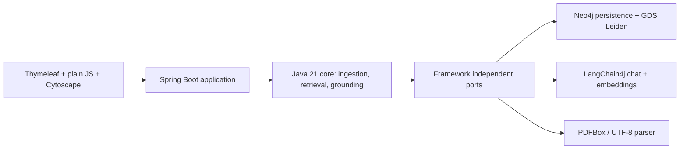

# Architecture and reusable core



- `core`: records, typed parsing/model/embedding/graph/vector/community ports, normalization, ingestion, four retrieval methods, source grounding and trace generation. It has no runtime framework dependencies.
- `adapter-neo4j`: transactional persistence, weighted GDS Leiden and explicit atomic file fallback.
- `adapter-model`: LangChain4j OpenAI-compatible JSON extraction, community summaries, follow-ups, answer generation and embeddings.
- `adapter-document`: strict UTF-8 and PDFBox extraction. PDF text retains page markers; scanned/locked/invalid PDFs return actionable errors.
- `web`: dependency injection, queue, SSE, API, lifecycle recovery, Thymeleaf and static assets.
- `contract-tests`: reusable storage contract assertions shared by file and Neo4j tests.

## Persistence and processing

Each corpus has an immutable ID and independent source/graph/vector data. Sources become ordered 6,000-character passages with 600-character overlap. Entity and relationship extraction are separate calls. Entity identities use NFKC normalization, full Unicode 16 case folding using the official vendored mapping table, whitespace cleanup and surrounding punctuation removal. Descriptions and source references merge; type conflicts pick the lexically smallest type. Relationship endpoints use final normalized identities; weights must be positive and finite. Stable writes are idempotent.

Ingestion persists each passage's newly extracted graph, detects communities of at least three members, summarizes them, and embeds entity/community descriptions. Independent 500-character chunks form the vector baseline. Progress events carry increasing sequence IDs and actual counts; SSE retains the latest 1,000 events per corpus and supports Last-Event-ID plus 15-second comment heartbeats. Terminal events close normally. The client merges graph updates by stable IDs and ignores repeated sequences.

Neo4j stores corpus metadata plus a complete JSON snapshot and materialized `Item:Document`, `Item:Passage`, `Item:Entity`, `Item:Community` and `Item:Chunk` nodes. `RELATED`, `SUPPORTED_BY` and `MEMBER_OF` relationships retain provenance. Embeddings are numerical properties. Every read/write/projection includes the corpus ID. A save replaces that corpus's materialized items in one transaction, retaining a consistent snapshot for readers; other corpora remain untouched. Active selection is persisted in `ExplorerSettings`. Startup marks interrupted BUILDING corpora FAILED.

## Retrieval and grounding

Local ranks approximately three seeds by keyword, semantic, identifier-aware or hybrid scoring; expands one hop; chooses up to ten weighted relationships and five source passages. Global selects up to three relevant community summaries and up to two supporting passages each. DRIFT begins with Global context, generates at most three follow-ups, records their parent community IDs, executes Local for each and deduplicates evidence. Vector ranks stored chunks by exact cosine similarity, inspects the top twelve ranked chunks and includes up to five positive matches in the answer.

No matches or missing communities remain explicit empty results. Numbered context contains actual passages/chunks; graph summaries provide retrieval background. Answers validate every `[n]` source marker, reject out-of-context numbers, renumber citations in appearance order and deduplicate them. Uncited output becomes no-answer. Citation validation proves source identity, not semantic entailment.

Every trace step is captured at execution time with stable targets, labels, scores, depth and branch metadata. A maximum of 1,000 recent traces per model engine are retained in memory; restarts remove them. Comparison runs methods sequentially, preserves successful answers when another fails and reports actual context, coverage, citations and nonoverlapping retrieval/embedding/generation timings. The evidence matrix preserves exact source identities and also maps overlapping vector chunk ranges to passage coverage.

## Library capabilities

Use `Domain`, `Ports`, `Ingestion`, `Retrieval` and `Answers` directly; Spring is unnecessary. Implement or select the required ports and pass dependencies through constructors.

```java
var settings = Domain.Settings.defaults();
var models = new OfflineModels();
var pipeline = new Ingestion(store, parser, models, models,
    new InProcessCommunities(), settings);
var corpus = pipeline.create("My corpus");
pipeline.process(corpus.id(), inputs, event -> System.out.println(event.message()));

var retrieval = new Retrieval(store, store, models, models, settings);
var context = retrieval.retrieve(corpus.id(), "Alice", Domain.Mode.LOCAL,
    Domain.Matching.IDENTIFIER); // Context and actual trace, without answer generation
var answers = new Answers(retrieval, models);
var answer = answers.query(corpus.id(), "Alice", Domain.Mode.LOCAL);
```

- `pipeline.importGraph(snapshot)`: persist an existing graph with supplied provenance without LLM extraction; validate referenced passage and entity IDs first. Set the provided corpus to READY when it is ready for queries. Supply communities/vectors if those retrieval modes are needed.
- `retrieval.retrieve(..., Matching.KEYWORD / SEMANTIC / IDENTIFIER / HYBRID)`: independently select seed matching. Identifier matching recognizes entity IDs and normalized names. Unavailable vectors produce no semantic match; hybrid retains its keyword component.
- `pipeline.removeSource(corpusId, documentId, progressSink)`: remove a document, then recompute all derived data from retained source text.
- `pipeline.replaceSource(corpusId, documentId, replacement, progressSink)`: replace source text and recompute derived data. Retained document/passages keep their identities; replacement uses the same document identity and fresh passage content.

Optional maps on documents/entities/passages and source locators allow structured knowledge graph extensions. Replacement/removal deliberately rebuilds all remaining derived data; it does not promise partial incremental model work.
